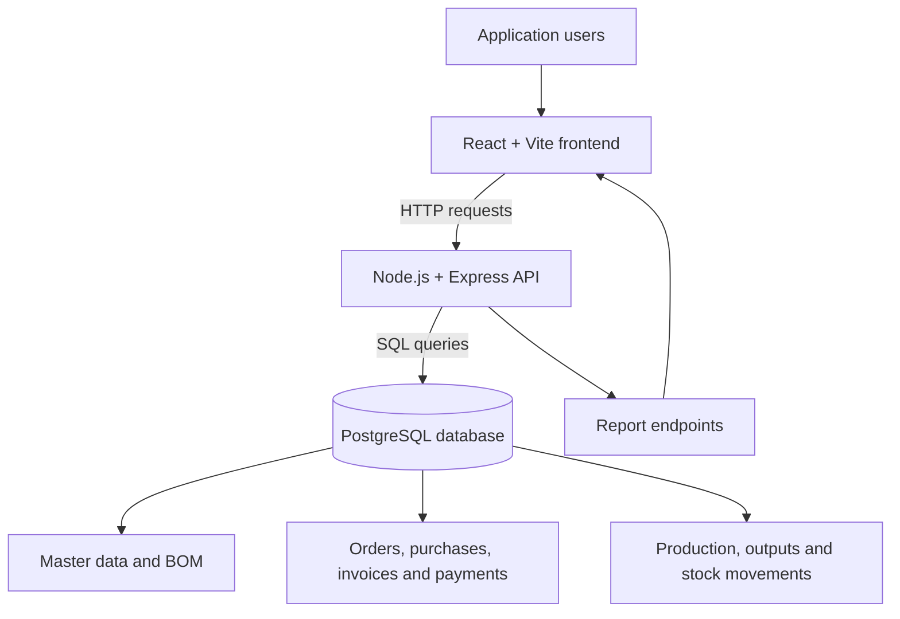

# OrderAudit – Order-to-Audit Manufacturing System

**Project:** Order-to-Audit System for a Small Food Manufacturer  
**Institutional context:** NIT Tiruchirappalli Internship Project  
**Application type:** Web-based manufacturing operations and reporting prototype

---

## 1. Project Overview

OrderAudit is a web-based prototype designed around the operational workflow of a small packaged-food manufacturer. It brings together purchasing, raw-material inventory, Bill of Materials (BOM), production recording, finished-goods inventory, sales orders, GST invoice records, dispatch, customer payments and management reports.

The system is demonstrated using a South Indian packaged-snack manufacturing example and the Murukku 200 g benchmark. The objective is to reduce fragmented records by recording operational transactions in a central PostgreSQL database and presenting them through a React application.

## 2. Problem Context

A small food manufacturer may maintain sales orders, purchases, stock balances, production consumption, invoices and collections in separate registers or spreadsheets. This makes it difficult to trace how a purchase affects raw-material stock, how a production batch consumes materials, how finished stock changes after dispatch, and how much a customer still owes.

OrderAudit addresses this by connecting two main workflows:

### 2.1 Production workflow

Purchase and receipt → Raw-material stock → Material issue against BOM → Production run → Finished-goods stock.

### 2.2 Sales workflow

Sales order → Administrative review → Invoice → Dispatch → Finished-goods stock reduction → Customer payment and outstanding balance.

Finished-goods inventory links the production and sales workflows. Reports bring together the resulting business records.

## 3. Project Objectives

- Maintain customer, product, supplier, unit and raw-material records.
- Record purchases and stock receipts.
- Define a BOM for a finished product.
- Record planned and actual material consumption for production.
- Record good production output and update inventory movements.
- Record sales orders, invoices, dispatch and customer payments.
- Calculate and display invoice tax components for the benchmark scenario.
- Provide operational reports and CSV exports.
- Compare planned and actual production consumption and output.

## 4. Technology Stack

| Layer | Technology |
|---|---|
| Frontend | React with Vite |
| Backend | Node.js |
| API framework | Express |
| Database | PostgreSQL |
| Node database client | `pg` |
| Environment configuration | `dotenv` |
| Cross-origin requests | `cors` |
| Development server reload | `nodemon` |

## 5. Application Modules

The following modules were present in the application and exercised during the project verification.

| Module | Demonstrated function |
|---|---|
| Dashboard | Main workspace and navigation |
| Sales Orders | Sales-order workspace |
| Invoices | Invoice listing and invoice records |
| Purchases | Purchase entry and purchase register data |
| Inventory | Current stock summary and stock ledger |
| Production | BOM selection, production run entry, material consumption and production history |
| Reports | Seven report views with CSV export |

### 5.1 Reports

The Reports workspace contains the following tabs:

1. Sales Register
2. GST Summary
3. Purchase Register
4. Stock Summary
5. Stock Ledger
6. Production
7. Payments & Outstanding

The Production report includes a material-consumption variance table with planned quantity, actual quantity, quantity variance, percentage variance and unit.

## 6. System Architecture

The application follows a three-layer structure:

1. **Presentation layer:** React/Vite frontend screens and report views.
2. **Application layer:** Node.js/Express API endpoints that validate requests and execute database operations.
3. **Data layer:** PostgreSQL tables that store master data, purchases, sales documents, production records, payments and stock movements.



## 7. Database Design

The database schema inspected during development contains the following operational tables:

- `customers`
- `sales_order_headers`
- `sales_order_items`
- `invoice_headers`
- `invoice_items`
- `customer_payments`
- `purchase_headers`
- `purchase_items`
- `products`
- `raw_materials`
- `units`
- `bom_headers`
- `bom_items`
- `production_runs`
- `production_consumption`
- `production_outputs`
- `stock_movements`

### 7.1 Important relationships

- A customer can have multiple sales orders and invoices.
- A sales order contains one or more order items.
- An invoice contains invoice items and can receive customer payments.
- A supplier can be associated with purchase records.
- A product can have a BOM.
- A BOM contains material requirements.
- A production run is associated with a BOM and product.
- Production consumption records store planned and actual quantities by material.
- Production output records store output quantities.
- Stock movements record inventory changes and their movement/source information.

The ER diagram supplied with the technical design note is a conceptual representation. It should be checked against the final database constraints before being treated as a complete physical schema diagram.

## 8. Inventory and Production Logic

### 8.1 Stock balance

The stock ledger follows the general movement equation:

**Closing stock = Opening stock + Receipts − Issues − Dispatches + Adjustments**

The exact sign convention depends on how each movement type is stored. The application’s stock summary was checked against the benchmark values below.

### 8.2 Bill of Materials

A Bill of Materials (BOM) defines the standard quantity of each input required for a specified batch output.

For the Murukku 200 g benchmark, one batch has an expected output of 200 packets.

| Material | Standard quantity | Unit |
|---|---:|---|
| Flour | 40 | kg |
| Cooking oil | 10 | L |
| Salt and spice mix | 1.2 | kg |
| 200 g packaging pouch | 200 | pcs |
| Carton (20 packets) | 10 | pcs |

### 8.3 Consumption variance

**Variance quantity = Actual consumption − Planned consumption**

**Variance % = (Actual consumption − Planned consumption) ÷ Planned consumption × 100**

Positive variance means more material was consumed than planned. Negative variance means actual consumption was below the BOM quantity.

### 8.4 Yield variance

**Yield variance % = (Actual good output − Planned output) ÷ Planned output × 100**

For 188 good packets against 200 planned packets:

`(188 − 200) ÷ 200 × 100 = −6%`

## 9. Benchmark Scenario and Verified Results

The project verification used the Murukku 200 g benchmark.

### 9.1 Purchase and production

- Opening flour stock: 100 kg.
- Flour purchase: 60 kg at ₹45/kg.
- Flour issued: 40 kg.
- Opening cooking oil: 30 L; actual issue: 10.5 L.
- Opening salt and spice: 5 kg; actual issue: 1.2 kg.
- Opening pouches: 500 pcs; actual consumption: 194 pcs.
- Opening cartons: 30 pcs; actual consumption: 9 pcs.
- Opening finished Murukku: 50 packets.
- Planned production: 200 packets.
- Good output: 188 packets.

### 9.2 Verified inventory balances

| Inventory item | Calculation | Verified closing balance |
|---|---|---:|
| Flour | 100 + 60 − 40 | 120 kg |
| Cooking oil | 30 − 10.5 | 19.5 L |
| Salt and spice mix | 5 − 1.2 | 3.8 kg |
| Packaging pouches | 500 − 194 | 306 pcs |
| Cartons | 30 − 9 | 21 pcs |
| Finished Murukku after production | 50 + 188 | 238 packets |
| Finished Murukku after dispatch | 238 − 150 | 88 packets |

### 9.3 Verified production variances

| Material | Planned | Actual | Variance quantity | Variance |
|---|---:|---:|---:|---:|
| Flour | 40 kg | 40 kg | 0 kg | 0% |
| Cooking oil | 10 L | 10.5 L | +0.5 L | +5% |
| Salt and spice | 1.2 kg | 1.2 kg | 0 kg | 0% |
| Packaging pouch | 200 pcs | 194 pcs | −6 pcs | −3% |
| Carton | 10 pcs | 9 pcs | −1 pc | −10% |

The benchmark describes six damaged pouches. The recorded pouch consumption is 194 pieces, which accounts for 188 good packets plus six damaged pouches. The production consumption report verifies the total consumed quantity. The production run history shown in the application recorded zero rejected finished-product output; damaged packaging should not be confused with rejected finished packets.

### 9.4 Sales invoice and collection

For Retailer A:

| Item | Amount |
|---|---:|
| Quantity | 150 packets |
| Selling price | ₹50 per packet |
| Taxable value | ₹7,500.00 |
| CGST (2.5% benchmark assumption) | ₹187.50 |
| SGST (2.5% benchmark assumption) | ₹187.50 |
| IGST | ₹0.00 |
| Invoice total | ₹7,875.00 |
| Payment received | ₹4,000.00 |
| Outstanding | ₹3,875.00 |

The 5% GST rate and intra-state tax split are benchmark assumptions, not tax advice. Product HSN and the applicable GST treatment must be verified before real-world invoicing.

### 9.5 Purchase record

The verified purchase register showed purchase `PUR-001` with a subtotal and total of ₹2,700, recorded as received. This corresponds to 60 kg flour × ₹45/kg.

### 9.6 Distributor shortage scenario

The benchmark scenario includes a request for 120 packets when only 88 packets remain after Retailer A dispatch. The shortage is 32 packets. Treat this as a benchmark stock-check scenario; demonstrate the application's actual order/stock response when presenting it.

## 10. Reports and Verification

The following report views and CSV exports were tested:

| Report | Verification |
|---|---|
| Sales Register | Invoice record and totals displayed |
| GST Summary | Taxable value and GST components displayed |
| Purchase Register | Purchase `PUR-001` and ₹2,700 total displayed |
| Stock Summary | Six inventory items and closing balances displayed |
| Stock Ledger | 14 movement records returned in the tested ledger |
| Production | Production run, output and yield variance displayed |
| Payments & Outstanding | ₹4,000 paid and ₹3,875 outstanding displayed |

The Production Material Consumption Variance report returned five material records for `PROD-001`, including the +5% cooking-oil variance.

## 11. API Verification

The following endpoints were opened and returned successful JSON responses during development:

- `GET /api/bom`
- `GET /api/bom/1`
- `GET /api/production`
- `GET /api/reports/production-consumption`

The application also retrieved stock, invoice, GST summary, purchase, stock-ledger and outstanding report data during testing.

## 12. Local Installation and Execution

### 12.1 Prerequisites

- Node.js and npm
- PostgreSQL
- A code editor such as Visual Studio Code
- The project source code and database SQL setup scripts

### 12.2 Database

1. Start PostgreSQL.
2. Create the database named `order_audit_db`.
3. Run the project's schema and seed SQL scripts in the correct order.
4. Confirm that master data, units, BOM and benchmark opening stock are loaded.

Use the actual SQL filenames from the project repository. The database password must remain private.

### 12.3 Backend

Open a terminal in the `backend` folder:

```bash
npm install
npm run dev
```

The demonstrated backend used port `5000`. The backend environment file is `backend/.env`. Use the exact variable names already read by the project's `server.js`. Do not upload `.env` or database credentials to GitHub.

### 12.4 Frontend

Open a second terminal in the frontend folder containing its `package.json`:

```bash
npm install
npm run dev
```

The frontend API helper defaults to `http://localhost:5000` when `VITE_API_URL` is not set. If an environment variable is used, set `VITE_API_URL` to the backend base URL.

Open the local Vite URL printed in the frontend terminal.

## 13. Assumptions and Limitations

- The GST rate of 5% is used only as a benchmark assumption.
- The product HSN placeholder must be replaced with a verified HSN before real invoices are issued.
- The tested costing calculation is an illustrative benchmark calculation. A complete operational costing module and a consistently applied inventory valuation policy were not verified in the demonstrated application flow.
- Offline order capture and synchronization were not verified in the tested flow.
- The screenshots and API tests establish the specific screens and responses tested; they do not by themselves establish production-grade security or complete role-based authorization.
- E-invoice, e-waybill and live tax-system integrations were not verified.
- Backup/restore, deployment hardening and automated test coverage require further validation.
- This is a functional prototype demonstrated with sample benchmark data, not a certified accounting or GST compliance product.

## 14. Future Enhancements

- Complete authentication and enforce role-based permissions on every protected API.
- Add offline-first sales order capture and reliable synchronization.
- Add a complete costing and inventory valuation module with a documented FIFO or weighted-average policy.
- Add production tolerance alerts and detailed scrap/damage reasons.
- Add batch and expiry tracking with FEFO stock handling.
- Add receivables ageing and richer export formats.
- Add automated integration tests, backup/restore and deployment hardening.
- Evaluate integrations with accounting and statutory systems only after compliance requirements are confirmed.

## 15. Conclusion

OrderAudit demonstrates how purchasing, inventory, BOM-based production, sales invoicing, dispatch, customer collections and reporting can be connected through a shared database. The Murukku 200 g benchmark was used to verify stock balances, material-consumption variance, production yield, invoice tax arithmetic and customer outstanding balance. The tested report views and CSV exports provide a consolidated operational view for review.

---

**Security reminder:** Never commit `.env`, database passwords, API secrets or personal credentials to a public repository.
